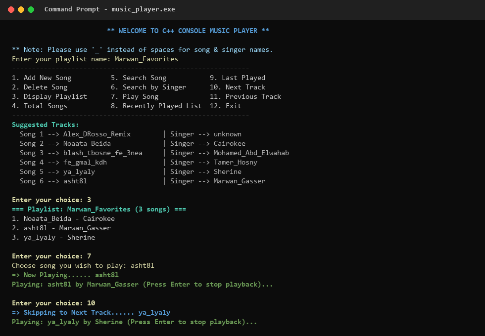

# C++ Console Music Player & Playlist Engine (Doubly Linked List)

A lightweight, zero-dependency C++ console music player built on Windows using a custom **Doubly Linked List** data structure and the **Windows Multimedia API (`winmm.lib`)** for real-time asynchronous `.wav` audio playback.



---

## Key Features

- **Custom Doubly Linked List Architecture:** Implements dynamic bidirectional node linking (`next` and `prev` pointers) for $O(1)$ track skipping forward and backward.
- **Real-Time Audio Playback:** Uses the native Windows Multimedia API (`PlaySoundW` with `SND_ASYNC | SND_LOOP`) to stream `.wav` files asynchronously while awaiting user controls.
- **Search & Filtering:**
  - Search track by exact song name (`O(N)` traversal).
  - Filter and list all tracks by a specific artist/singer (`O(N)` traversal).
- **Playback History Stack:** Tracks recently played songs in chronological order (`std::vector<std::pair<string, string>>`) to display full listening history or query the last played track in $O(1)$ time.
- **Safe Node Deletion:** Properly unlinks `head`, middle, or tail nodes and frees heap memory (`delete temp`) without dangling pointers.

---

## Data Structure Design

```
NULL <-- [Prev | Song 1 | Next] <===> [Prev | Song 2 | Next] <===> [Prev | Song 3 | Next] --> NULL
               ^
              head
```

Each track in the playlist is represented by a `node` struct:
```cpp
struct node {
    string song;
    string singer;
    node* next;
    node* prev;
};
```

| Operation | Function | Time Complexity | Description |
| :--- | :--- | :---: | :--- |
| **Add Song** | `add_node(song, singer)` | $O(N)$ | Appends a new track node at the end of the playlist |
| **Delete Song** | `delet(song)` | $O(N)$ | Removes a track and updates adjacent `prev`/`next` pointers |
| **Play Song** | `play(song)` | $O(N)$ | Locates the track, pushes to history stack, and starts `.wav` playback |
| **Next / Prev Track** | `next_song()` / `prev_song()` | $O(1)$ step | Jumps directly to `current->next` or `current->prev` |
| **Last Played** | `lastOneplayed()` | $O(1)$ | Retrieves the top item from the playback history vector |

---

## How to Build & Run (Windows)

### Option 1: Visual Studio (MSVC)
Open the Developer Command Prompt or Visual Studio and compile:
```bat
cl /EHsc music_player.cpp /link winmm.lib
music_player.exe
```

### Option 2: MinGW / g++
```bash
g++ music_player.cpp -o music_player.exe -lwinmm
./music_player.exe
```

> **Note:** Place `.wav` files matching the track names (e.g., `asht8l.wav`, `Noaata_Beida.wav`) in the working directory for audio output. Use underscores (`_`) instead of spaces when entering track or artist names in the console.

---

## Author

**Marwan Gasser Mohamed**
- [GitHub](https://github.com/Marwangasser1)
- [LinkedIn](https://www.linkedin.com/in/marwan-gasser-42a306247/)
